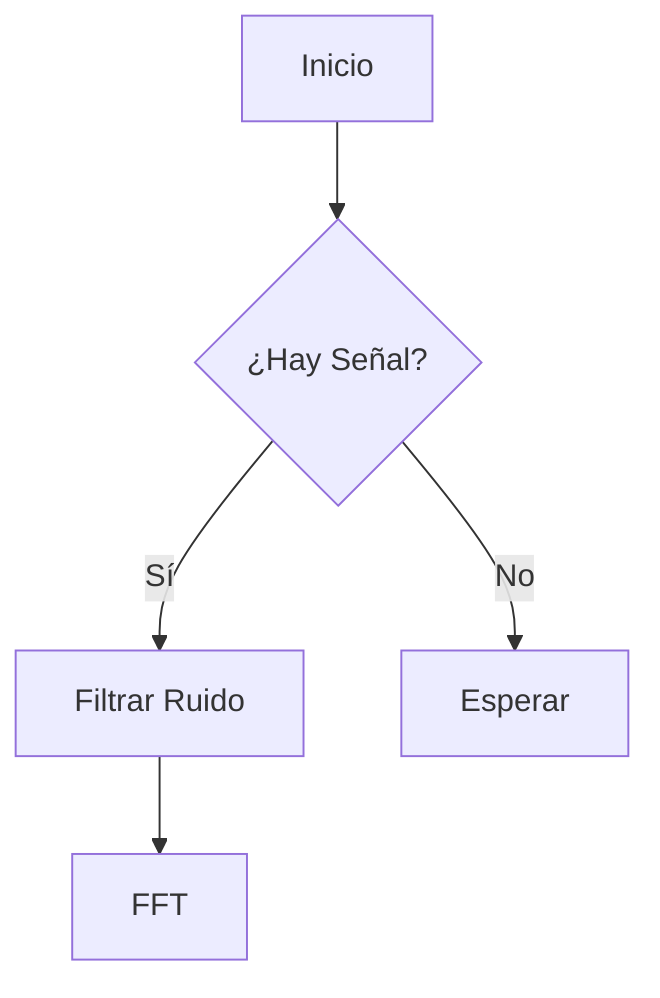

<figure style="text-align: center; margin-top: 20px; margin-bottom: 20px;"> 
	 
	
	
 
		<b>
			Región Xalapa, Facultad de Instrumentación Electrónica
		</b> 
	
 
</figure> 

 
	

		<b class="azul-uv">Manual de prácticas.
		</b>
		   
	

	

		 
		 <b class="azul-uv">Programa académico:</b> Ingeniería Biomédica
		 
		   
		 <b class="azul-uv">EE:</b> Programación de Microcontroladores
		 
		    
		 
		 
	
 

		 <b class="azul-uv">Integrantes:</b> 
			 Alfonso Gamboa, Rubén  
			 Gomez Lopez, Rafael  
			 Juncal Rojas, Leobardo  
			 Flores Montero, Edsel Yetlanezi   
			 
		 <b class="azul-uv">Catedrático:</b>Gallardo del Angel, Agustín
	
 
	
	

		Fecha: 12 de diciembre de 2025 
	
 

 

 

<h2 style="text-align: left;" class="azul-uv">
	

		Índice de Contenido
	

</h2> 

 
	<ul style="list-style-type: none; padding: 0;"> 
		<li style="border-bottom: 1px dotted #ccc; margin-bottom: 5px; display: flex; justify-content: space-between;">  
			<a 
			href="#Abstract" 
			style="text-decoration: none; color: #444444; display: block; width: 100%;">  
				Abstract  
			</a> 
			 
				[Link] 
			  
		</li>
		<li style="border-bottom: 1px dotted #ccc; margin-bottom: 5px; display: flex; justify-content: space-between;">  
			<a 
			href="#Resumen" 
			style="text-decoration: none; color: #444444; display: block; width: 100%;">  
				Resumen
			</a> 
			 
				[Link] 
			  
		</li>
		<li style="border-bottom: 1px dotted #ccc; margin-bottom: 5px; display: flex; justify-content: space-between;">  
			<a 
			href="#Introducción" 
			style="text-decoration: none; color: #444444; display: block; width: 100%;">  
				Introducción
			</a> 
			 
				[Link] 
			  
		</li>
		<li style="border-bottom: 1px dotted #ccc; margin-bottom: 5px; display: flex; justify-content: space-between;">  
			<a 
			href="#Casos de uso" 
			style="text-decoration: none; color: #444444; display: block; width: 100%;">  
			--- Casos de uso
			</a> 
			 
				[Link] 
			  
		</li>
		<li style="border-bottom: 1px dotted #ccc; margin-bottom: 5px; display: flex; justify-content: space-between;">  
			<a 
			href="#Conclusiones" 
			style="text-decoration: none; color: #444444; display: block; width: 100%;">  
				Conclusiones 
			</a> 
			 
				[Link] 
			  
		</li>
		<li style="border-bottom: 1px dotted #ccc; margin-bottom: 5px; display: flex; justify-content: space-between;">  
			<a 
			href="#Referencias" 
			style="text-decoration: none; color: #444444; display: block; width: 100%;">  
				Referencias  
			</a> 
			 
				[Link] 
			  
		</li>
	</ul> 

 

<h1 style="text-align: center;">
	

		Informe de Señales Electromiográficas
	

</h1> 

  

 
	
 
		<b class="azul-uv">ABSTRACT:</b> 
			<i>
				La empatía es una capacidad fundamental que trasciende la simple conexión emocional; se constituye como una competencia paralela con utilidad en los niveles personal, académico y profesional. 
			</i>
	
 

 

 
	
 
		<b class="azul-uv">RESUMEN:</b> 
			La empatía es una capacidad fundamental que trasciende la simple conexión emocional; se constituye como una competencia paralela con utilidad en los niveles personal, académico y profesional. 
	
 

 

	<h3 id="Introducción">
		Introducción
	</h3> 
		

			El análisis de señales electromiográficas (EMG) es crucial para el desarrollo de prótesis mioeléctricas. En este proyecto utilizamos un microcontrolador STM32 para la adquisición de datos.[<a style="font-size: 0.7em;" href="#1">1</a>] Este es un texto de relleno para demostrar cómo fluye el contenido en la columna izquierda. Lorem ipsum dolor sit amet, consectetur adipiscing elit 
			<h4 id="Casos de uso" >
				Casos de Uso (Ejemplos) 
			</h4>
		

	 
	

 

 
	<b>[AQUI IRÍA TU IMAGEN VERTICAL]
	</b> 
	   
		 

 
	
 <i>
		Fig. 1. Electrodo de superficie (Vista Vertical).
		</i> 
	
 

 
	

		El texto continúa fluyendo naturalmente debajo de la imagen vertical. Ahora veremos un ejemplo de diagrama de flujo lógico. 
	

 
 

 

 
	<i>
		Fig. 1. Texto de Mermaid
	</i> 

 

Para el filtrado digital, utilizamos la ecuación de diferencia estándar:

$$y[n] = \sum_{k=0}^{M} b_k x[n-k]$$

Donde $b_k$ son los coeficientes del filtro FIR diseñado en MATLAB.

-------

	Sin embargo, para el cálculo de la Transformada de Fourier en tiempo continuo que requiere una visualización completa, expandimos la ecuación a lo ancho de la hoja:

 

 

 

$$X(\omega) = \int_{-\infty}^{\infty} x(t) e^{-j\omega t} dt \approx \sum_{n=0}^{N-1} x[n] e^{-j 2\pi k n / N}$$

	Eq. 1. Aproximación discreta para el microcontrolador

 

 
	

		Como se observa en la Eq. 1, la complejidad computacional aumenta. A continuación, mostramos el diagrama completo del sistema.
	

 

 
	<i>
		Fig. 3. Diagrama de bloques completo del sistema de rehabilitación (Horizontal).
	</i> 

 

 
	

También capturamos una muestra de 5 segundos de contracción muscular isométrica que requiere vista panorámica.
	

 

 
	 
	
 
		<i>
			Fig. 4. Señal cruda de 5 segundos (Vista Panorámica).
		</i> 
	
 

 
	<h3>
		Conclusiones
	</h3> 

	El sistema demostró ser eficiente para detectar fatiga muscular. La implementación en el microcontrolador permitió un procesamiento en tiempo real con una latencia menor a 20ms.
	

	Este formato modular en Obsidian permite insertar cualquier tipo de contenido manteniendo el estilo IEEE profesional exigido en la Facultad de Instrumentación Electrónica.

 

<h2 style="text-align: left;">
	

		Referencias
	

</h2>

 
	<ol class="ieee-ref-list"> 
		

		<li>J. G. Proakis and D. G. Manolakis, 
			<i>
				Digital Signal Processing: Principles, Algorithms, and Applications
			</i>
				, 4th ed. Upper Saddle River, NJ: Pearson Prentice Hall, 2007.
		</li> 
		

		

		<li>
			E. Y. Flores Montero, "Reporte de Prácticas de Microcontroladores", Universidad Veracruzana, 2024.
		</li>
		

		

		 <li>
			 Texas Instruments, "INA128 Precision, Low Power Instrumentation Amplifiers Datasheet," SBOS051B, Oct. 1995.
		 </li> 
		 

		

		 <li>A. V. Oppenheim and R. W. Schafer, 
		 <i>
			 Discrete-Time Signal Processing
		 </i>
			 , 3rd ed. Pearson, 2010.
		 </li> 
		 

	</ol>

